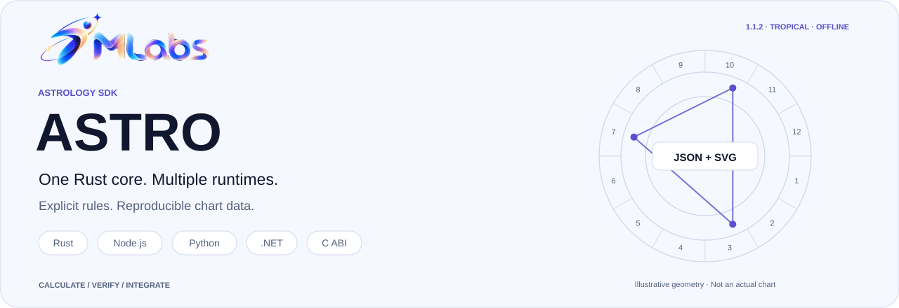
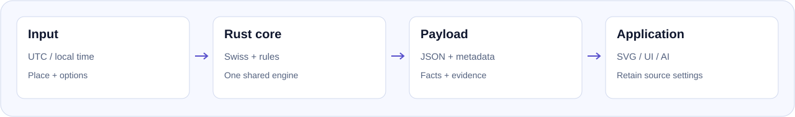

# 7mlabs Astro SDK

<picture>
  <source media="(prefers-color-scheme: dark)" srcset="docs/assets/readme/hero.en.dark.svg">
  <source media="(prefers-color-scheme: light)" srcset="docs/assets/readme/hero.en.light.svg">
  
</picture>

[Tiếng Việt](README.md) · **English**

<p align="center">
<a href="LICENSE"><picture><source media="(prefers-color-scheme: dark)" srcset="docs/assets/readme/badge-license.dark.svg"><source media="(prefers-color-scheme: light)" srcset="docs/assets/readme/badge-license.light.svg"></picture></a>
<picture><source media="(prefers-color-scheme: dark)" srcset="docs/assets/readme/badge-rust.dark.svg"><source media="(prefers-color-scheme: light)" srcset="docs/assets/readme/badge-rust.light.svg"></picture>
<picture><source media="(prefers-color-scheme: dark)" srcset="docs/assets/readme/badge-offline.dark.svg"><source media="(prefers-color-scheme: light)" srcset="docs/assets/readme/badge-offline.light.svg"></picture>
<a href="docs/rules.md"><picture><source media="(prefers-color-scheme: dark)" srcset="docs/assets/readme/badge-system.dark.svg"><source media="(prefers-color-scheme: light)" srcset="docs/assets/readme/badge-system.light.svg"></picture></a>
</p>

[Quick start](#quick-start) · [Features](#features) · [Formulas](docs/features-and-formulas.md) · [Rules](docs/rules.md) · [Verification](docs/formula-verification.md) · [Web guides](https://7mlabs.com/en/astro/sdk/docs/1.1.2/overview/)

**Astro SDK 1.1.2 by 7mlabs** is an offline Rust engine using Swiss Ephemeris to calculate charts, relationships and astronomical events inside your application. Node.js/TypeScript, Python, .NET, Rust and C share the calculation core; no engine server or external calculation API is needed.

Results contain **numbers, effective settings, selection policies and evidence**. SVG and chart models support presentation. Narrative interpretation and compatibility scoring belong to the consuming application.

<a id="features"></a>
<a id="capabilities"></a>

## Available features

| Scope | API / operation | Main output |
| --- | --- | --- |
| Individual chart | `natal` | Sun–Pluto, signs, houses, angles and aspects; additional points are opt-in. |
| Domain data | `natalDomains` | One natal, 10 domains/30 sections, derived facts, rulers and evidence; custom profiles supported. |
| Two-chart comparison | `couple` | Two natals, synastry, house overlays and 6 relationship views; optional composite. |
| Midpoint chart | `composite` | Symbolic chart C from shortest-arc midpoints, without an invented epoch or physical velocities. |
| Davison chart | `davison` | Recalculated sky at derived time/place; uncorrected or MC-corrected. |
| Events and transits | `events`, `forecast` | Ingresses, stations, Moon phases, aspects and global eclipses; forecast adds natal transits. |
| Supplied geometry | `chart`, `harmonic`, `synastry` | Signs, houses, aspects, midpoints or harmonic transformations of supplied positions. |
| Focused queries | `geometry`, `aspects`, `houses`, `points` | 8 helpers backed by `query`; see [query API](docs/query.md). |
| Time conversion | `resolveBirthTime`, `calculateFromLocal` | Offline IANA/offset local-to-UTC conversion, explicit DST handling. |
| Presentation | `renderChartSvg`, `renderChartPart`, `buildChartModel` | Full/modular SVG, colors/filters and JSON chart models for custom UIs. |
| Context preparation | `compressPayload`, `expandContext`, `calculateWithContext` | Compression or scoped context with explicit coverage/omissions and metadata. |

Names above follow Node.js. Python uses snake_case and .NET uses PascalCase; operation IDs and JSON keys stay unchanged. See the [feature/formula/payload mapping](docs/features-and-formulas.md).

<a id="rules"></a>

## Calculation system and rules

**1.1.2 calculates tropical, geocentric, apparent ecliptic-of-date positions with Placidus or Whole Sign houses.** Moshier supplies the ten main bodies; optional Chiron uses embedded asteroid data. No separate Swiss installation is required.

`rulership: traditional | modern` selects the ruler table, not a zodiac system. Sign-only dignity flags retain explicitly declared traditional rules. Composite and Davison are distinct methods. `includeMetadata: true` opts into additional metadata; caller-declared geometry remains unverified.

- [Features and formulas](docs/features-and-formulas.md): calculations, arithmetic examples and output paths.
- [Calculation rules](docs/rules.md): defaults, units, time, policies and limits.
- [Sources and verification](docs/formula-verification.md): source code, tests, independent comparisons and limits of the evidence.
- [Payload metadata](docs/payload-metadata.md): required/optional metadata and unverified geometry declarations.

<a id="platforms"></a>
<a id="install"></a>

## Installation and platforms

| Package 1.1.2 | Runtime | Published native targets |
| --- | --- | --- |
| [`@7mlabs/astrology`](https://www.npmjs.com/package/@7mlabs/astrology/v/1.1.2) | Node.js ≥18; tested 18/24 | macOS ARM64, Linux x64 |
| [`sevenmlabs-astrology`](https://pypi.org/project/sevenmlabs-astrology/1.1.2/) | Python ≥3.10; tested 3.10/3.13 | macOS ARM64, Linux x64 |
| [`SevenMLabs.Astrology`](https://www.nuget.org/packages/SevenMLabs.Astrology/1.1.2) | .NET 10 / net10.0 | osx-arm64, linux-x64 |
| Rust / C | Source integration and C ABI | [Build instructions](docs/packages.md); no separate crates.io package |

Linux requires **glibc ≥2.38 and libgcc_s.so.1**, tested on Ubuntu 24.04. Ubuntu 22.04, Debian 12, Alpine/musl, Windows, Intel Mac and Linux ARM64 are outside this binary matrix. macOS native deployment target is 11.0; the selected language runtime has its own OS requirements. **Browser WASM is not included**; a frontend can call a backend/desktop host using the SDK.

```sh
npm install --save-exact @7mlabs/astrology@1.1.2
python -m pip install sevenmlabs-astrology==1.1.2
dotnet add package SevenMLabs.Astrology --version 1.1.2
```

These are separate language choices, not three required installations. [Linux wheel details](docs/python-linux.md).

## From input to application

<picture>
  <source media="(prefers-color-scheme: dark)" srcset="docs/assets/readme/calculation-flow.en.dark.svg">
  <source media="(prefers-color-scheme: light)" srcset="docs/assets/readme/calculation-flow.en.light.svg">
  
</picture>

<a id="quick-start"></a>

## Quick start

All three bindings use the same fictional Gregorian UTC input. Metadata is explicitly requested; no additional points are selected, so `placements` contains ten bodies.

### Node.js / TypeScript

```js
const astro = require('@7mlabs/astrology');
const payload = astro.calculate({
  operation: 'natal',
  utc: { year: 2000, month: 1, day: 1, hour: 12, minute: 0 },
  location: { latitude: 10.8231, longitude: 106.6297 },
  houseSystem: 'placidus',
  includeMetadata: true
});
console.log(payload.engineVersion, payload.data.placements.length); // 1.1.2 10
const svg = astro.renderChartPart(payload, 'wheel');
```

### Python

```python
import sevenmlabs_astrology as astro
payload = astro.calculate({
    "operation": "natal",
    "utc": {"year": 2000, "month": 1, "day": 1, "hour": 12, "minute": 0},
    "location": {"latitude": 10.8231, "longitude": 106.6297},
    "houseSystem": "placidus",
    "includeMetadata": True,
})
print(payload["engineVersion"], len(payload["data"]["placements"]))  # 1.1.2 10
svg = astro.render_chart_part(payload, "wheel")
```

### .NET

```csharp
using SevenMLabs.Astrology;
var payload = Engine.Calculate(new {
    operation = "natal",
    utc = new { year = 2000, month = 1, day = 1, hour = 12, minute = 0 },
    location = new { latitude = 10.8231, longitude = 106.6297 },
    houseSystem = "placidus",
    includeMetadata = true
});
Console.WriteLine($"{payload.GetProperty("engineVersion")} {payload.GetProperty("data").GetProperty("placements").GetArrayLength()}");
var svg = Engine.RenderChartPart(payload, "wheel");
```

Node/Python/.NET object APIs throw structured errors on calculation failure; raw JSON APIs retain the error envelope. Calculation calls are synchronous; use application workers for long searches. [C/Rust and other consumers](docs/packages.md).

<details>
<summary><strong>Starting with local civil time</strong></summary>

```js
const payload = astro.calculateFromLocal({
  operation: 'natal',
  local: { year: 2000, month: 1, day: 1, hour: 19, minute: 0 },
  timeZone: 'Asia/Ho_Chi_Minh',
  location: { latitude: 10.8231, longitude: 106.6297 },
  includeMetadata: true
});
```

This is the same instant as the UTC example. Coordinates do not infer a timezone. Nonexistent DST times fail; repeated times need an explicit earlier/later choice. [Time and SVG](docs/time-and-svg.md).

</details>

<a id="payload"></a>

## Actual payload example

[Sample request](docs/examples/natal-request.json) · [Actual 1.1.2 response](docs/examples/natal-response.json) · [Geometry example](docs/examples/geometry-request.json).

The envelope contains `schemaVersion`, `engineVersion`, `calculation`, `data`, `warnings` and `errors`. `schemaVersion: "1.0"` identifies the JSON contract, not the package release. Keep source settings with exported data for UI/AI consumers; do not infer a calculation school from the brand or a domain label.

<a id="docs"></a>

## Find the right document

| Goal | Reference |
| --- | --- |
| Understand each calculation | [Features and formulas](docs/features-and-formulas.md) |
| Compare with another calculator | [Rules](docs/rules.md), [verification scope](docs/formula-verification.md) |
| Natal and optional points | [Natal](docs/natal.md), [domains](docs/domains.md) |
| Relationship data | [Couple](docs/couple.md), [composite](docs/composite.md), [Davison](docs/davison.md) |
| Events and transits | [Forecast/events](docs/forecast.md) |
| Custom selections | [Profiles](docs/profiles.md), [reports](docs/individual-reports.md) |
| UI, MCP or compressed context | [Integration](docs/integrations.md), [compression](docs/payload-compression.md), [SVG](docs/time-and-svg.md) |
| Language-specific setup | [Node](bindings/node/README.md), [Python](bindings/python/README.md), [.NET](bindings/dotnet/README.md) |

<a id="validation"></a>

## Verification and releases

1.1.2 adds a Python Linux x64 wheel; calculation code, APIs and schemas remain unchanged from 1.1.1. Release evidence includes 339 shared conformance cases across bindings, Python 3.10/3.13 and Node 18/24 across macOS ARM64/Linux x64, plus fresh public-registry installations. [The 1.1.2 report and checksums](docs/release-1.1.2.md) identify the exact source and tested scope.

Davison was introduced in 1.1.0; optional metadata in 1.1.1. [CHANGELOG](CHANGELOG.md) retains history. Formula documents explain the current implementation, not a new algorithm release or universal agreement between astrology traditions.

<a id="development"></a>

## Development and contributions

The shared Rust core lives in [neutral-engine](neutral-engine/Cargo.toml), wrappers in `bindings/`, schemas in `schemas/`, and cross-language fixtures in `tests/conformance/`. [Architecture](docs/architecture.md) · [Testing](docs/testing.md) · [Distribution](docs/distribution.md).

Sidereal/ayanamsa, topocentric natal, progression/return charts, Browser WASM and native targets outside the matrix are not implemented. CLI/MCP/worker samples are separate integrations; there is no built-in worker pool or cancellation of an individual running native calculation.

<a id="license"></a>

## License and provenance

Astro uses **AGPL-3.0-only**, whereas Numerology uses MIT. [LICENSE](LICENSE), [NOTICE](NOTICE), [license details](docs/license.md) and [pinned Swiss source](neutral-engine/crates/astro-provider-swiss/PROVENANCE.md) accompany the project. This documentation refresh changes neither the license, package version nor existing published artifacts.
