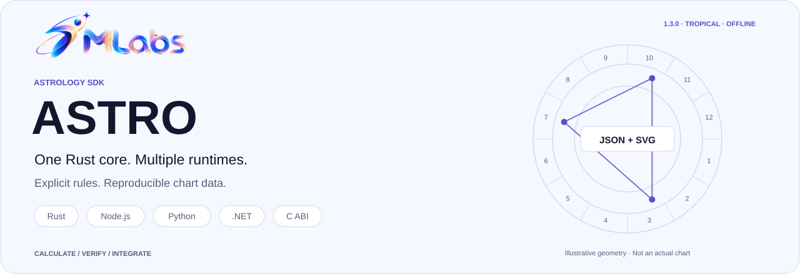
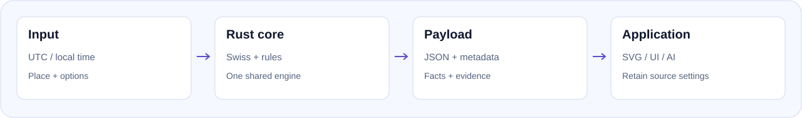

# 7mlabs Astro SDK

<picture>
  <source media="(prefers-color-scheme: dark)" srcset="docs/assets/readme/hero.en.dark.svg">
  <source media="(prefers-color-scheme: light)" srcset="docs/assets/readme/hero.en.light.svg">
  
</picture>

[Tiếng Việt](README.md) · **English**

<p align="center">
<a href="LICENSE"><picture><source media="(prefers-color-scheme: dark)" srcset="docs/assets/readme/badge-license.dark.svg"><source media="(prefers-color-scheme: light)" srcset="docs/assets/readme/badge-license.light.svg"></picture></a>
<picture><source media="(prefers-color-scheme: dark)" srcset="docs/assets/readme/badge-rust.dark.svg"><source media="(prefers-color-scheme: light)" srcset="docs/assets/readme/badge-rust.light.svg"></picture>
<picture><source media="(prefers-color-scheme: dark)" srcset="docs/assets/readme/badge-offline.dark.svg"><source media="(prefers-color-scheme: light)" srcset="docs/assets/readme/badge-offline.light.svg"></picture>
<a href="docs/rules.md"><picture><source media="(prefers-color-scheme: dark)" srcset="docs/assets/readme/badge-system.dark.svg"><source media="(prefers-color-scheme: light)" srcset="docs/assets/readme/badge-system.light.svg"></picture></a>
</p>

[Quick start](#quick-start) · [Features](#features) · [Horary](#horary) · [Release history](#validation) · [Formulas](docs/features-and-formulas.md) · [Rules](docs/rules.md) · [Verification](docs/formula-verification.md) · [1.1.3 web guides](https://7mlabs.com/en/astro/sdk/docs/1.1.3/overview/)

**Astro SDK 1.2.2 by 7mlabs** is an offline Rust engine using Swiss Ephemeris to calculate charts, relationships and astronomical events inside your application. Node.js/TypeScript, Python, .NET, Rust and C share the calculation core; no engine server or external calculation API is needed.

Results contain **numbers, effective settings, selection policies and evidence**. SVG and chart models support presentation. Narrative interpretation and compatibility scoring belong to the consuming application.

<a id="features"></a>
<a id="capabilities"></a>

## Available features

| Scope | API / operation | Main output |
| --- | --- | --- |
| Individual chart | `natal` | Sun–Pluto, signs, houses, angles and aspects; additional points are opt-in. |
| Horary question chart | `horary` | Seven classical bodies, house rulers, significators, Void-of-Course Moon and a chart wheel in SVG. |
| Domain data | `natalDomains` | One natal, 10 domains/30 sections, derived facts, rulers and evidence; custom profiles supported. |
| Two-chart comparison | `couple` | Two natals, synastry, house overlays and 6 relationship views; optional composite. |
| Midpoint chart | `composite` | Symbolic chart C from shortest-arc midpoints, without an invented epoch or physical velocities. |
| Davison chart | `davison` | Recalculated sky at derived time/place; uncorrected or MC-corrected. |
| Events and transits | `events`, `forecast` | Ingresses, stations, Moon phases, aspects and global eclipses; forecast adds natal transits. |
| Supplied geometry | `chart`, `harmonic`, `synastry` | Signs, houses, aspects, midpoints or harmonic transformations of supplied positions. |
| Focused queries | `geometry`, `aspects`, `houses`, `points` | 8 helpers backed by `query`; see [query API](docs/query.md). |
| Time conversion | `resolveBirthTime`, `calculateFromLocal` | Offline IANA/offset local-to-UTC conversion, explicit DST handling. |
| Presentation | `renderChartSvg`, `renderChartPart`, `buildChartModel` | Full/modular SVG, colors/filters and JSON chart models for custom UIs. |
| Context preparation | `compressPayload`, `expandContext`, `calculateWithContext` | Compression or scoped context with explicit coverage/omissions and metadata. |

Names above follow Node.js. Python uses snake_case and .NET uses PascalCase; operation IDs and JSON keys stay unchanged. See the [feature/formula/payload mapping](docs/features-and-formulas.md).

<a id="rules"></a>

## Calculation system and rules

**The SDK calculates tropical, geocentric, apparent ecliptic-of-date positions.** Natal charts support Placidus and Whole Sign houses. Horary defaults to Regiomontanus. The SDK convention also accepts Placidus or Whole Sign. The Lilly profile requires Regiomontanus. Moshier supplies the ten main bodies; optional Chiron uses embedded asteroid data. No separate Swiss installation is required.

`rulership: traditional | modern` selects the ruler table, not a zodiac system. Sign-only dignity flags retain explicitly declared traditional rules. Composite and Davison are distinct methods. `includeMetadata: true` opts into additional metadata; caller-declared geometry remains unverified.

- [Features and formulas](docs/features-and-formulas.md): calculations, arithmetic examples and output paths.
- [Calculation rules](docs/rules.md): defaults, units, time, policies and limits.
- [Sources and verification](docs/formula-verification.md): source code, tests, independent comparisons and limits of the evidence.
- [Payload metadata](docs/payload-metadata.md): required/optional metadata and unverified geometry declarations.

<a id="platforms"></a>
<a id="install"></a>

## Installation and platforms

| Package 1.2.2 | Runtime | Native targets |
| --- | --- | --- |
| [`@7mlabs/astrology`](https://www.npmjs.com/package/@7mlabs/astrology/v/1.2.2) | Node.js ≥18; test matrix 18/24 | macOS ARM64, Linux x64 |
| [`sevenmlabs-astrology`](https://pypi.org/project/sevenmlabs-astrology/1.2.2/) | Python ≥3.10; test matrix 3.10/3.13 | macOS ARM64, Linux x64 |
| [`SevenMLabs.Astrology`](https://www.nuget.org/packages/SevenMLabs.Astrology/1.2.2) | .NET 10 / net10.0 | osx-arm64, linux-x64 |
| Rust / C | Source integration and C ABI | [Build instructions](docs/packages.md); no separate crates.io package |

Linux requires **glibc ≥2.38 and libgcc_s.so.1**. The Linux CI target is Ubuntu 24.04. Ubuntu 22.04, Debian 12, Alpine/musl, Windows, Intel Mac and Linux ARM64 are outside this binary matrix. macOS native deployment target is 11.0; the selected language runtime has its own OS requirements. **Browser WASM is not included**; a frontend can call a backend/desktop host using the SDK.

```sh
npm install --save-exact @7mlabs/astrology@1.2.2
python -m pip install sevenmlabs-astrology==1.2.2
dotnet add package SevenMLabs.Astrology --version 1.2.2
```

These are separate language choices, not three required installations. [Linux wheel details](docs/python-linux.md).

## From input to application

<picture>
  <source media="(prefers-color-scheme: dark)" srcset="docs/assets/readme/calculation-flow.en.dark.svg">
  <source media="(prefers-color-scheme: light)" srcset="docs/assets/readme/calculation-flow.en.light.svg">
  
</picture>

<a id="quick-start"></a>

## Quick start

All three bindings use the same fictional Gregorian UTC input. Metadata is explicitly requested; no additional points are selected, so `placements` contains ten bodies.

### Node.js / TypeScript

```js
const astro = require('@7mlabs/astrology');
const payload = astro.calculate({
  operation: 'natal',
  utc: { year: 2000, month: 1, day: 1, hour: 12, minute: 0 },
  location: { latitude: 10.8231, longitude: 106.6297 },
  houseSystem: 'placidus',
  includeMetadata: true
});
console.log(payload.engineVersion, payload.data.placements.length); // 1.2.2 10
const svg = astro.renderChartPart(payload, 'wheel');
```

### Python

```python
import sevenmlabs_astrology as astro
payload = astro.calculate({
    "operation": "natal",
    "utc": {"year": 2000, "month": 1, "day": 1, "hour": 12, "minute": 0},
    "location": {"latitude": 10.8231, "longitude": 106.6297},
    "houseSystem": "placidus",
    "includeMetadata": True,
})
print(payload["engineVersion"], len(payload["data"]["placements"]))  # 1.2.2 10
svg = astro.render_chart_part(payload, "wheel")
```

### .NET

```csharp
using SevenMLabs.Astrology;
var payload = Engine.Calculate(new {
    operation = "natal",
    utc = new { year = 2000, month = 1, day = 1, hour = 12, minute = 0 },
    location = new { latitude = 10.8231, longitude = 106.6297 },
    houseSystem = "placidus",
    includeMetadata = true
});
Console.WriteLine($"{payload.GetProperty("engineVersion")} {payload.GetProperty("data").GetProperty("placements").GetArrayLength()}");
var svg = Engine.RenderChartPart(payload, "wheel");
```

Node/Python/.NET object APIs throw structured errors on calculation failure; raw JSON APIs retain the error envelope. Calculation calls are synchronous; use application workers for long searches. [C/Rust and other consumers](docs/packages.md).

<details>
<summary><strong>Starting with local civil time</strong></summary>

```js
const payload = astro.calculateFromLocal({
  operation: 'natal',
  local: { year: 2000, month: 1, day: 1, hour: 19, minute: 0 },
  timeZone: 'Asia/Ho_Chi_Minh',
  location: { latitude: 10.8231, longitude: 106.6297 },
  includeMetadata: true
});
```

This is the same instant as the UTC example. Coordinates do not infer a timezone. Nonexistent DST times fail; repeated times need an explicit earlier/later choice. [Time and SVG](docs/time-and-svg.md).

</details>

<a id="horary"></a>

## Horary in SDK 1.2.2

Pass the **time and location of the question** in `moment`. House 1 represents the querent. The application selects `quesitedHouse` (1–12) for the subject of the question. The SDK returns the traditional domicile ruler of each cusp sign. Both roles can share a ruler. Save `calculation.ruleset` with the result so readers can identify the conventions used.

| What does your application need? | Select `ruleset` | When is the Moon recorded as void of course? |
| --- | --- | --- |
| A fixed-orb aspect calendar or reproduction of a 1.2.0–1.2.1 chart | `western-traditional-v1` (default), a calculation convention defined by 7mlabs. | No major contact between the Moon and the other six classical bodies becomes exact after the question and before the next sign ingress. |
| The William Lilly indicators implemented by the SDK | `lilly-1647-v1` (explicit selection, Regiomontanus houses). | At the question instant the SDK looks for both a separating contact still within orb and an applying contact already within orb. If either is absent, `isVoidOfCourse = true`. The applying contact can become exact after ingress. |

**Aspect calculation.** For two ecliptic longitudes in [0°, 360°), let `d = abs(λ₁ − λ₂)` and `s = min(d, 360° − d)`. For a major angle `A` of 0°, 60°, 90°, 120° or 180°, the deviation from exact is `orb = abs(s − A)`. The SDK includes the contact in `data.chart.aspects` when `orb ≤ maxOrb`.

- **SDK convention.** The limit for a 60° sextile is 6°. The other four angles use 8°. These limits select chart aspects at the question instant. The before-ingress Moon search uses the time of exact contact.
- **SDK’s Lilly convention.** The limit is `maxOrb = (O₁ + O₂) / 2`. The SDK selects the first column of Lilly’s table on p. 107: Sun 17°, Moon 12.5°, Mercury 7°, Venus 8°, Mars 7.5°, Jupiter 12°, Saturn 10°. The Moon–Saturn limit is therefore **11.25°**. The SDK also reports the distance to the next house cusp when the distance in house order is greater than 0° and at most 5°. [Sources, lunar convention and output fields](docs/release-1.2.2.md)

**Same question moment in Ho Chi Minh City, 20 November 2026 at 10:58:40 (UTC+7).**

```js
const { calculate } = require('@7mlabs/astrology');
const moment = {
  utc: { year: 2026, month: 11, day: 20, hour: 3, minute: 58, second: 40 },
  location: { latitude: 10.8231, longitude: 106.6297 }
};
for (const ruleset of ['western-traditional-v1', 'lilly-1647-v1']) {
  const r = calculate({ operation: 'horary', moment, quesitedHouse: 7, ruleset });
  const moon = r.data.voidOfCourseMoon;
  console.log(r.calculation.ruleset, moon.isVoidOfCourse, moon.nextAspect?.otherBodyId ?? null);
}
```

The two rows report `true, null` and `false, saturn`. The Moon changes sign at about **05:52 UTC** and reaches conjunction with Saturn at about **20:44 UTC** that day. At the question instant it is still separating from a trine to the Sun and is **9.36°** from conjunction with Saturn, inside the 11.25° limit. This accounts for the different flags. The application interprets the evidence in the context of the question.

**Proposed development.** The default profile prioritizes compatibility and accuracy against its specification. For Lilly, the proposed 1.3.0 milestone covers dignities, reception and turned houses. The proposed 1.4.0 milestone covers aspect history and the conditions for perfection or interruption. [Integration guide and roadmap](docs/horary.en.md)

<a id="payload"></a>

## Actual payload example

[Sample request](docs/examples/natal-request.json) · [Actual response from the public 1.1.3 package](docs/examples/natal-response.json) · [Geometry example](docs/examples/geometry-request.json).

The envelope contains `schemaVersion`, `engineVersion`, `calculation`, `data`, `warnings` and `errors`. `schemaVersion: "1.0"` identifies the JSON contract, not the package release. Keep source settings with exported data for UI/AI consumers; do not infer a calculation school from the brand or a domain label.

<a id="docs"></a>

## Find the right document

| Goal | Reference |
| --- | --- |
| Understand each calculation | [Features and formulas](docs/features-and-formulas.md) |
| Compare with another calculator | [Rules](docs/rules.md), [verification scope](docs/formula-verification.md) |
| Natal and optional points | [Natal](docs/natal.md), [domains](docs/domains.md) |
| Horary question chart | [Inputs, significators and Moon course](docs/horary.en.md) |
| Relationship data | [Couple](docs/couple.md), [composite](docs/composite.md), [Davison](docs/davison.md) |
| Events and transits | [Forecast/events](docs/forecast.md) |
| Custom selections | [Profiles](docs/profiles.md), [reports](docs/individual-reports.md) |
| UI, MCP or compressed context | [Integration](docs/integrations.md), [compression](docs/payload-compression.md), [SVG](docs/time-and-svg.md) |
| Language-specific setup | [Node](bindings/node/README.md), [Python](bindings/python/README.md), [.NET](bindings/dotnet/README.md) |

<a id="validation"></a>

## Verification and releases

**The latest release is 1.2.2, published on 21 November 2026 on npm, PyPI and NuGet.** Fresh installations from the three registries matched across 339 cases per binding. [Release assets and checksums](https://github.com/7mLabs/sdk-astro/releases/tag/v1.2.2) · [Verification record](docs/release-1.2.2.md)

| Version | What shipped |
| --- | --- |
| [1.2.2](docs/release-1.2.2.md) | Adds the opt-in Lilly conventions. Omitting `ruleset` still selects the SDK default. |
| [1.2.1](docs/release-1.2.1.md) | Corrects and verifies the Python wheel file inventory. Horary uses the 1.2.0 formulas. |
| [1.2.0](docs/release-1.2.0.md) | Introduces Horary with the SDK convention, significators, Moon course and question-chart SVG. |
| [1.1.3](docs/release-1.1.3.md) | Ships the scoped MIT grant for identified 7mlabs contributions. The complete native distribution uses AGPL-3.0-only. |
| [1.1.2](docs/release-1.1.2.md) | Adds a Linux x64 Python wheel (glibc 2.38+) alongside macOS ARM64. |
| [1.1.1](docs/release-1.1.1.md) | Adds optional metadata for calculation identity and provenance. |
| [1.1.0](docs/release-1.1.0.md) | Adds the corrected and uncorrected Davison relationship charts. |
| [1.0.1 → 1.0.2](docs/release-1.0.2.md) | 1.0.1 fixes SVG request validation on npm only. 1.0.2 carries that fix and corrected installation instructions to all three registries. |
| [1.0.0](docs/release-1.0.md) | Coordinated three-registry release with offline local-time conversion and SVG rendering. |
| [0.10.0-alpha.1 → 0.10.1](CHANGELOG.md) | The public npm alpha ships the offline engine. 0.10.0 moves to the stable channel and 0.10.1 updates npm metadata. |

<a id="development"></a>

## Development and contributions

The shared Rust core lives in [neutral-engine](neutral-engine/Cargo.toml), wrappers in `bindings/`, schemas in `schemas/`, and cross-language fixtures in `tests/conformance/`. [Architecture](docs/architecture.md) · [Testing](docs/testing.md) · [Distribution](docs/distribution.md).

Sidereal/ayanamsa, topocentric natal, progression/return charts, Browser WASM and native targets outside the matrix are not implemented. CLI/MCP/worker samples are separate integrations; there is no built-in worker pool or cancellation of an individual running native calculation.

<a id="license"></a>

## License and provenance

The public combined native distribution uses **AGPL-3.0-only**. Original 7mlabs-owned contributions identified in the [permission scope](LICENSE-SCOPE.md) and [inventory](LICENSE-SCOPE.json) additionally carry a [separate MIT permission](LICENSE-7MLABS-MIT), including the precisely identified original 7mlabs changes to Swiss source. This does not license Swiss code/data or the entire combined binary under MIT. Professional holders need appropriate Swiss permission for their actual use under their own agreement; we have not confirmed that the existing prebuilt binaries can automatically be used under Professional.

[English licensing guide](docs/license.en.md) · [Giải thích tiếng Việt](docs/license.md) · [Full AGPL](LICENSE) · [NOTICE](NOTICE) · [Pinned Swiss provenance](neutral-engine/crates/astro-provider-swiss/PROVENANCE.md).

**1.1.3** carries the additional permission and scope files in the installation packages; that permission covers only inventoried contributions. Already published **1.1.2 archives are unchanged** and are not overwritten or repackaged. The separately granted MIT rights for covered revisions remain in effect; shipping the files in 1.1.3 does not change Swiss rights.
