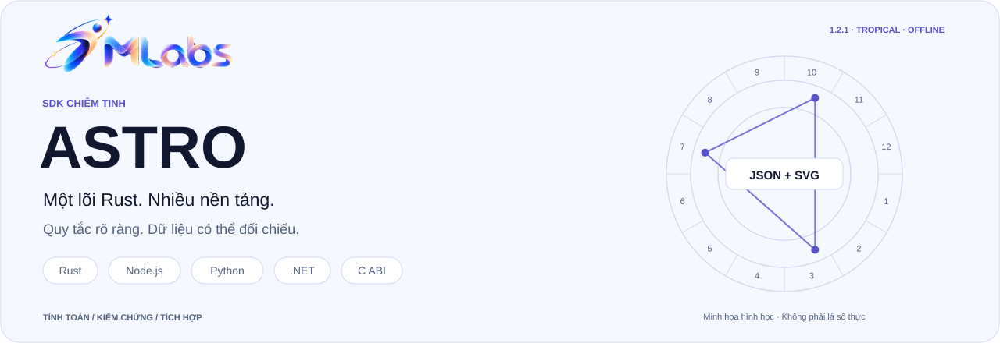
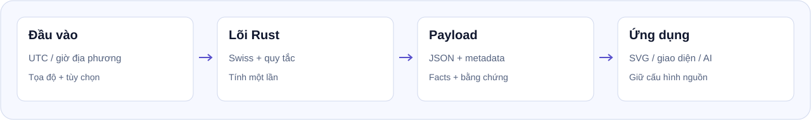

# 7mlabs Astro SDK

<picture>
  <source media="(prefers-color-scheme: dark)" srcset="docs/assets/readme/hero.vi.dark.svg">
  <source media="(prefers-color-scheme: light)" srcset="docs/assets/readme/hero.vi.light.svg">
  
</picture>

**Tiếng Việt** · [English](README.en.md)

<p align="center">
<a href="LICENSE"><picture><source media="(prefers-color-scheme: dark)" srcset="docs/assets/readme/badge-license.dark.svg"><source media="(prefers-color-scheme: light)" srcset="docs/assets/readme/badge-license.light.svg"></picture></a>
<picture><source media="(prefers-color-scheme: dark)" srcset="docs/assets/readme/badge-rust.dark.svg"><source media="(prefers-color-scheme: light)" srcset="docs/assets/readme/badge-rust.light.svg"></picture>
<picture><source media="(prefers-color-scheme: dark)" srcset="docs/assets/readme/badge-offline.dark.svg"><source media="(prefers-color-scheme: light)" srcset="docs/assets/readme/badge-offline.light.svg"></picture>
<a href="docs/rules.vi.md"><picture><source media="(prefers-color-scheme: dark)" srcset="docs/assets/readme/badge-system.dark.svg"><source media="(prefers-color-scheme: light)" srcset="docs/assets/readme/badge-system.light.svg"></picture></a>
</p>

[Bắt đầu](#quick-start) · [Chức năng](#features) · [Horary](#horary) · [Lịch sử phiên bản](#validation) · [Công thức](docs/features-and-formulas.vi.md) · [Quy tắc](docs/rules.vi.md) · [Kiểm chứng](docs/formula-verification.vi.md) · [Tài liệu web 1.1.3](https://7mlabs.com/astro/sdk/docs/1.1.3/overview/)

**Astro SDK 1.3.0** của **7mlabs** dùng lõi Rust và Swiss Ephemeris để tính lá số, quan hệ và sự kiện thiên văn ngay trong ứng dụng. Cùng một engine cho Node.js/TypeScript, Python, .NET, Rust và C; không cần máy chủ tính toán hay gọi API bên ngoài.

Đầu ra gồm **số liệu, cấu hình tính, quy tắc lựa chọn dữ liệu và bằng chứng**. SDK có SVG và model cho giao diện; phần viết luận giải hoặc chấm điểm tương hợp thuộc ứng dụng tích hợp.

<a id="features"></a>
<a id="capabilities"></a>

## Chức năng hiện có

| Phạm vi | API / operation | Đầu ra chính |
| --- | --- | --- |
| Lá số cá nhân | `natal` | 10 thiên thể Sun–Pluto, cung, nhà, góc trục và góc chiếu; điểm mở rộng bật riêng. |
| Bản đồ sao câu hỏi | `horary` | Bảy thiên thể cổ điển, chủ tinh các nhà, hành tinh đại diện, chỉ báo Void-of-Course Moon và lá số SVG. |
| Dữ liệu theo lĩnh vực | `natalDomains` | Một natal, 10 nhóm/30 mục, facts, chủ tinh và nguồn bằng chứng; có custom profiles. |
| So sánh hai lá số | `couple` | Hai natal, synastry, house overlays và 6 nhóm dữ liệu quan hệ; tùy chọn composite. |
| Lá số trung điểm | `composite` | Chart C tượng trưng từ trung điểm cung ngắn; không giả ngày sinh hoặc tốc độ vật lý. |
| Lá số Davison | `davison` | Tính lại bầu trời ở trung điểm thời gian/địa điểm; `uncorrected` hoặc `corrected` theo MC. |
| Sự kiện và quá cảnh | `events`, `forecast` | Ingress, station, pha Mặt Trăng, góc chiếu, nhật/nguyệt thực toàn cầu; forecast thêm quá cảnh với natal. |
| Hình học từ tọa độ có sẵn | `chart`, `harmonic`, `synastry` | Cung, nhà, góc chiếu, trung điểm hoặc phép nhân harmonic trên positions của bên gọi. |
| Truy vấn theo nhu cầu | `geometry`, `aspects`, `houses`, `points` | 8 helper qua operation `query`; xem [API](docs/query.md). |
| Đổi giờ | `resolveBirthTime`, `calculateFromLocal` | Giờ địa phương → UTC, IANA/offset ngoại tuyến, xử lý DST rõ ràng. |
| Trình bày biểu đồ | `renderChartSvg`, `renderChartPart`, `buildChartModel` | SVG đầy đủ/từng phần, màu và bộ lọc; JSON model cho UI riêng. |
| Chuẩn bị context | `compressPayload`, `expandContext`, `calculateWithContext` | Nén hoặc chọn phạm vi dữ liệu; công bố phần giữ/bỏ và metadata. |

Tên trên dùng kiểu Node.js. Python dùng snake_case; .NET dùng PascalCase. Tên operation và trường JSON giữ nguyên giữa các ngôn ngữ. [Bảng chức năng, công thức và vị trí trong payload](docs/features-and-formulas.vi.md).

<a id="rules"></a>

## Hệ tính toán và quy tắc

**SDK dùng tọa độ tropical, geocentric, apparent, ecliptic-of-date.** Lá số natal hỗ trợ Placidus và Whole Sign. Horary mặc định dùng Regiomontanus. Bộ quy ước SDK cũng cho phép chọn Placidus hoặc Whole Sign. Bộ Lilly yêu cầu Regiomontanus. Moshier cho 10 thiên thể chính; Chiron tùy chọn dùng dữ liệu tiểu hành tinh nhúng sẵn. Không cần cài Swiss Ephemeris riêng.

`rulership: traditional | modern` chọn bảng chủ tinh; **không** đổi hệ hoàng đạo, và các cờ dignity vẫn theo quy tắc truyền thống được ghi rõ. Composite và Davison là hai phương pháp khác nhau. `includeMetadata: true` thêm metadata tùy chọn; không biến tọa độ bên gọi cung cấp thành dữ liệu đã được engine xác minh.

- [Chức năng và công thức](docs/features-and-formulas.vi.md): phép tính, ví dụ số học và trường kết quả.
- [Quy tắc tính](docs/rules.vi.md): mặc định, đơn vị, thời gian, chính sách và giới hạn.
- [Nguồn và kiểm chứng](docs/formula-verification.vi.md): mã nguồn, kiểm thử, đối chiếu độc lập và phạm vi kết luận.
- [Metadata payload](docs/payload-metadata.md): phần bắt buộc/tùy chọn và nguồn geometry chưa xác minh.

<a id="platforms"></a>
<a id="install"></a>

## Cài đặt và nền tảng

| Gói 1.3.0 | Runtime | Target native |
| --- | --- | --- |
| [`@7mlabs/astrology`](https://www.npmjs.com/package/@7mlabs/astrology/v/1.3.0) | Node.js ≥18; matrix kiểm thử 18/24 | macOS ARM64, Linux x64 |
| [`sevenmlabs-astrology`](https://pypi.org/project/sevenmlabs-astrology/1.3.0/) | Python ≥3.10; matrix kiểm thử 3.10/3.13 | macOS ARM64, Linux x64 |
| [`SevenMLabs.Astrology`](https://www.nuget.org/packages/SevenMLabs.Astrology/1.3.0) | .NET 10 / net10.0 | osx-arm64, linux-x64 |
| Rust / C | Tích hợp source và C ABI | [Hướng dẫn build](docs/packages.md); chưa có gói crates.io riêng |

Linux cần **glibc ≥2.38 và libgcc_s.so.1**. Môi trường CI cho Linux là Ubuntu 24.04. Ubuntu 22.04, Debian 12, Alpine/musl, Windows, Intel Mac và Linux ARM64 chưa có binary phù hợp trong bản này. Native macOS có deployment target 11.0; runtime được chọn còn có yêu cầu OS riêng. **Chưa chạy trực tiếp trong browser bằng WASM**; frontend có thể gọi backend/desktop host dùng SDK.

```sh
npm install --save-exact @7mlabs/astrology@1.3.0
python -m pip install sevenmlabs-astrology==1.3.0
dotnet add package SevenMLabs.Astrology --version 1.3.0
```

Ba dòng là ba lựa chọn theo ngôn ngữ, không cần cài cả ba. [Chi tiết wheel Linux](docs/python-linux.md).

## Từ dữ liệu đến ứng dụng

<picture>
  <source media="(prefers-color-scheme: dark)" srcset="docs/assets/readme/calculation-flow.vi.dark.svg">
  <source media="(prefers-color-scheme: light)" srcset="docs/assets/readme/calculation-flow.vi.light.svg">
  
</picture>

<a id="quick-start"></a>

## Bắt đầu nhanh

Dùng cùng dữ liệu Gregory UTC giả lập trên cả ba binding. Ví dụ này bật metadata rõ ràng; không bật thêm điểm mở rộng nên `placements` có 10 thiên thể.

### Node.js / TypeScript

```js
const astro = require('@7mlabs/astrology');
const payload = astro.calculate({
  operation: 'natal',
  utc: { year: 2000, month: 1, day: 1, hour: 12, minute: 0 },
  location: { latitude: 10.8231, longitude: 106.6297 },
  houseSystem: 'placidus',
  includeMetadata: true
});
console.log(payload.engineVersion, payload.data.placements.length); // 1.3.0 10
const svg = astro.renderChartPart(payload, 'wheel');
```

### Python

```python
import sevenmlabs_astrology as astro
payload = astro.calculate({
    "operation": "natal",
    "utc": {"year": 2000, "month": 1, "day": 1, "hour": 12, "minute": 0},
    "location": {"latitude": 10.8231, "longitude": 106.6297},
    "houseSystem": "placidus",
    "includeMetadata": True,
})
print(payload["engineVersion"], len(payload["data"]["placements"]))  # 1.3.0 10
svg = astro.render_chart_part(payload, "wheel")
```

### .NET

```csharp
using SevenMLabs.Astrology;
var payload = Engine.Calculate(new {
    operation = "natal",
    utc = new { year = 2000, month = 1, day = 1, hour = 12, minute = 0 },
    location = new { latitude = 10.8231, longitude = 106.6297 },
    houseSystem = "placidus",
    includeMetadata = true
});
Console.WriteLine($"{payload.GetProperty("engineVersion")} {payload.GetProperty("data").GetProperty("placements").GetArrayLength()}");
var svg = Engine.RenderChartPart(payload, "wheel");
```

Node/Python/.NET object API ném lỗi có cấu trúc khi engine báo lỗi; API JSON thô giữ envelope với `errors`. Các lời gọi tính toán chạy đồng bộ; dùng worker của ứng dụng cho lượt quét dài. [Ví dụ C/Rust và các consumer](docs/packages.md).

<details>
<summary><strong>Nếu đầu vào là giờ Việt Nam hoặc múi giờ khác</strong></summary>

```js
const payload = astro.calculateFromLocal({
  operation: 'natal',
  local: { year: 2000, month: 1, day: 1, hour: 19, minute: 0 },
  timeZone: 'Asia/Ho_Chi_Minh',
  location: { latitude: 10.8231, longitude: 106.6297 },
  includeMetadata: true
});
```

Đây là cùng thời điểm 12:00 UTC ở ví dụ trên. Tọa độ không tự suy múi giờ. Giờ DST không tồn tại bị từ chối; giờ lặp phải chọn sớm/muộn rõ ràng. [Đổi giờ và SVG](docs/time-and-svg.md).

</details>

<a id="horary"></a>

## Horary trong SDK 1.2.2

Truyền **giờ và địa điểm của câu hỏi** vào `moment`. Nhà 1 đại diện người hỏi. Ứng dụng chọn `quesitedHouse` (1–12) cho đối tượng được hỏi. SDK trả chủ tinh truyền thống của cung tại mỗi đỉnh nhà. Hai vai trò có thể cùng một chủ tinh. Hãy lưu `calculation.ruleset` cùng kết quả để biết cách đọc các chỉ báo.

| Bạn muốn làm gì? | Chọn `ruleset` | Khi nào Mặt Trăng được ghi là vô hành? |
| --- | --- | --- |
| Làm lịch góc chiếu theo orb cố định hoặc tái tạo kết quả 1.2.0–1.2.1 | `western-traditional-v1` (mặc định). Đây là quy ước tính của 7mlabs. | Không có góc chính nào giữa Mặt Trăng và sáu thiên thể cổ điển còn lại đạt chính xác sau lúc hỏi và trước lần đổi cung kế tiếp. |
| Lấy các chỉ báo đã triển khai theo William Lilly | `lilly-1647-v1` (chọn tường minh, dùng Regiomontanus). | SDK xét hai điều kiện tại lúc hỏi: còn một góc đang tách trong orb và có một góc đang tiến tới trong orb. Thiếu một trong hai thì `isVoidOfCourse = true`. Góc đang tiến tới có thể hoàn tất sau khi đổi cung. |

**Cách tính orb.** Với hai kinh độ hoàng đạo từ 0° đến dưới 360°, đặt `d = abs(λ₁ − λ₂)` và `s = min(d, 360° − d)`. Với góc chính `A` bằng 0°, 60°, 90°, 120° hoặc 180°, độ lệch là `orb = abs(s − A)`. SDK ghi góc vào `data.chart.aspects` khi `orb ≤ maxOrb`.

- **Quy ước SDK:** ngưỡng cho góc 60° là 6°. Bốn góc còn lại dùng 8°. Các ngưỡng này dùng để liệt kê góc tại thời điểm hỏi. Phép dò Mặt Trăng trước khi đổi cung xét thời điểm góc đạt chính xác.
- **Quy ước Lilly trong SDK:** `maxOrb = (O₁ + O₂) / 2`. SDK chọn cột đầu bảng orb ở trang 107: Mặt Trời 17°, Mặt Trăng 12,5°, Thủy 7°, Kim 8°, Hỏa 7,5°, Mộc 12°, Thổ 10°. Ví dụ, cặp Mặt Trăng–Sao Thổ có ngưỡng **11,25°**. SDK cũng trả khoảng cách tới đỉnh nhà kế tiếp khi khoảng cách theo chiều thứ tự nhà lớn hơn 0° và tối đa 5°. [Nguồn, quy ước Mặt Trăng và các trường JSON](docs/release-1.2.2.md)

**Cùng một câu hỏi tại TP.HCM, 10:58:40 ngày 20/11/2026 (UTC+7).**

```js
const { calculate } = require('@7mlabs/astrology');
const moment = {
  utc: { year: 2026, month: 11, day: 20, hour: 3, minute: 58, second: 40 },
  location: { latitude: 10.8231, longitude: 106.6297 }
};
for (const ruleset of ['western-traditional-v1', 'lilly-1647-v1']) {
  const r = calculate({ operation: 'horary', moment, quesitedHouse: 7, ruleset });
  const moon = r.data.voidOfCourseMoon;
  console.log(r.calculation.ruleset, moon.isVoidOfCourse, moon.nextAspect?.otherBodyId ?? null);
}
```

Kết quả lần lượt là `true, null` và `false, saturn`. Mặt Trăng đổi cung khoảng **05:52 UTC**, rồi mới giao hội với Sao Thổ khoảng **20:44 UTC** cùng ngày. Tại lúc hỏi, Mặt Trăng vẫn trong orb của góc tam hợp đang tách với Mặt Trời và cách góc giao hội với Sao Thổ **9,36°**, trong ngưỡng 11,25°. Đây là lý do cùng một bầu trời cho hai nhãn khác nhau. Ứng dụng chịu trách nhiệm luận câu hỏi từ các dữ kiện đó.

**Hướng phát triển đề xuất:** bộ mặc định ưu tiên tính tương thích và độ chính xác theo đặc tả. Với Lilly, giai đoạn kế tiếp hướng tới phẩm chất hành tinh, tiếp nhận và nhà phái sinh. Mốc 1.4.0 hướng tới lịch sử góc và các điều kiện hoàn tất hoặc gián đoạn (*perfection*). Cả hai mốc đang ở mức đề xuất. [Hướng dẫn tích hợp và lộ trình](docs/horary.md)

<a id="payload"></a>

## Payload thực tế

[Request mẫu](docs/examples/natal-request.json) · [Response thật từ gói công khai 1.1.3](docs/examples/natal-response.json) · [Ví dụ hình học](docs/examples/geometry-request.json).

Envelope gồm `schemaVersion`, `engineVersion`, `calculation`, `data`, `warnings`, `errors`. `schemaVersion: "1.0"` là hợp đồng JSON, không phải phiên bản gói. Giữ cấu hình nguồn cùng dữ liệu khi đưa cho UI/AI; đừng suy trường phái từ tên thương hiệu hay tên nhóm báo cáo.

<a id="docs"></a>

## Tra cứu theo nhu cầu

| Bạn muốn | Đọc tiếp |
| --- | --- |
| Biết từng chức năng tính gì | [Chức năng và công thức](docs/features-and-formulas.vi.md) |
| So sánh kết quả với công cụ khác | [Quy tắc](docs/rules.vi.md), [phạm vi kiểm chứng](docs/formula-verification.vi.md) |
| Tính natal và điểm mở rộng | [Natal](docs/natal.md), [domains](docs/domains.md) |
| Bản đồ sao câu hỏi Horary | [Đầu vào, hành tinh đại diện và Void-of-Course Moon](docs/horary.md) |
| Dùng dữ liệu hai người | [Couple](docs/couple.md), [composite](docs/composite.md), [Davison](docs/davison.md) |
| Quét sự kiện và quá cảnh | [Forecast/events](docs/forecast.md) |
| Tạo nhóm dữ liệu riêng | [Profiles](docs/profiles.md), [reports](docs/individual-reports.md) |
| Tích hợp UI, MCP hoặc nén context | [Tích hợp](docs/integrations.md), [nén payload](docs/payload-compression.md), [SVG](docs/time-and-svg.md) |
| Cài theo ngôn ngữ | [Node](bindings/node/README.md), [Python](bindings/python/README.md), [.NET](bindings/dotnet/README.md) |

<a id="validation"></a>

## Kiểm chứng và phiên bản

**Bản 1.2.2 phát hành ngày 21/11/2026 trên npm, PyPI và NuGet.** Cài thử từ cả ba kho cho kết quả khớp ở 339 ca trên mỗi binding. [Bản phát hành và checksum](https://github.com/7mLabs/sdk-astro/releases/tag/v1.2.2) · [Hồ sơ kiểm thử](docs/release-1.2.2.md)

| Phiên bản | Thay đổi đã phát hành |
| --- | --- |
| [1.3.0](docs/release-1.3.0.md) | Transit Range trả lần đổi nhà, toàn bộ khoảng trong orb và các nhóm giao nhau. |
| [1.2.2](docs/release-1.2.2.md) | Bổ sung tùy chọn Lilly. Lời gọi bỏ qua `ruleset` vẫn dùng bộ mặc định. |
| [1.2.1](docs/release-1.2.1.md) | Sửa danh mục tệp và kiểm tra hash trong wheel Python. Horary dùng cùng công thức với 1.2.0. |
| [1.2.0](docs/release-1.2.0.md) | Ra mắt Horary với bộ quy ước SDK, chủ tinh, chỉ báo Mặt Trăng và SVG lá số câu hỏi. |
| [1.1.3](docs/release-1.1.3.md) | Đóng gói văn bản MIT và phạm vi cấp quyền bổ sung cho phần đóng góp của 7mlabs. Toàn bộ gói native dùng AGPL-3.0-only. |
| [1.1.2](docs/release-1.1.2.md) | Bổ sung wheel Python cho Linux x64 (glibc 2.38+) bên cạnh macOS ARM64. |
| [1.1.1](docs/release-1.1.1.md) | Bổ sung metadata tùy chọn để truy nguồn và nhận diện phép tính. |
| [1.1.0](docs/release-1.1.0.md) | Thêm lá số quan hệ Davison với hai biến thể corrected và uncorrected. |
| [1.0.1 → 1.0.2](docs/release-1.0.2.md) | 1.0.1 sửa kiểm tra JSON khi vẽ SVG và chỉ lên npm. 1.0.2 mang bản sửa cùng hướng dẫn cài đặt đã hiệu chỉnh lên cả ba kho. |
| [1.0.0](docs/release-1.0.md) | Phát hành đồng bộ ba kho, đổi giờ địa phương ngoại tuyến và vẽ SVG từ kết quả tính. |
| [0.10.0-alpha.1 → 0.10.1](CHANGELOG.md) | Bản alpha công khai trên npm có lõi tính ngoại tuyến. 0.10.0 lên kênh ổn định. 0.10.1 cập nhật metadata npm. |

<a id="development"></a>

## Phát triển và đóng góp

Một lõi Rust trong [neutral-engine](neutral-engine/Cargo.toml); các wrapper ở `bindings/`; schema ở `schemas/`; kiểm chứng đa ngôn ngữ ở `tests/conformance/`. [Kiến trúc](docs/architecture.md) · [Kiểm thử](docs/testing.md) · [Cách phân phối](docs/distribution.md).

Chưa triển khai Sidereal/ayanamsa, topocentric natal, progression/return charts, Browser WASM và các binary ngoài ma trận trên. CLI/MCP/worker mẫu là phần tích hợp riêng; chưa có worker pool hoặc hủy riêng từng phép tính native đang chạy.

<a id="license"></a>

## Giấy phép và nguồn

Bản phân phối native công khai dùng **AGPL-3.0-only**. Phần đóng góp gốc thuộc 7mlabs được xác định trong [phạm vi cấp quyền](LICENSE-SCOPE.md) và [kiểm kê](LICENSE-SCOPE.json) còn có [quyền MIT riêng](LICENSE-7MLABS-MIT), bao gồm đúng phần sửa Swiss thuộc 7mlabs được nhận diện bởi diff. Quyền này không chuyển code/dữ liệu Swiss hay toàn bộ binary kết hợp thành MIT. Người có Swiss Professional phải có quyền phù hợp cho cách sử dụng thực tế theo hợp đồng của họ; chưa xác nhận các binary dựng sẵn hiện tại tự động được dùng theo Professional.

[Giải thích tiếng Việt](docs/license.md) · [English licensing guide](docs/license.en.md) · [AGPL đầy đủ](LICENSE) · [NOTICE](NOTICE) · [Nguồn Swiss đã pin](neutral-engine/crates/astro-provider-swiss/PROVENANCE.md).

**1.1.3** đóng kèm bộ tệp cấp quyền và phạm vi MIT trong các gói cài đặt; quyền bổ sung chỉ áp dụng cho những đóng góp được kiểm kê. Các gói **1.1.2 đã phát hành giữ nguyên**, không được ghi đè hay đóng gói lại. Quyền MIT đã cấp riêng cho các revision thuộc phạm vi vẫn tồn tại; việc thêm tệp vào 1.1.3 không đổi quyền của Swiss.
