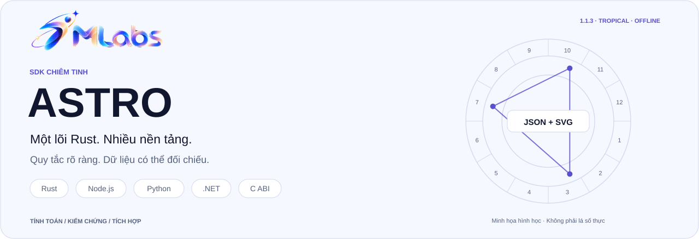
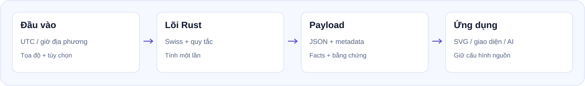

# 7mlabs Astro SDK

<picture>
  <source media="(prefers-color-scheme: dark)" srcset="docs/assets/readme/hero.vi.dark.svg">
  <source media="(prefers-color-scheme: light)" srcset="docs/assets/readme/hero.vi.light.svg">
  
</picture>

**Tiếng Việt** · [English](README.en.md)

<p align="center">
<a href="LICENSE"><picture><source media="(prefers-color-scheme: dark)" srcset="docs/assets/readme/badge-license.dark.svg"><source media="(prefers-color-scheme: light)" srcset="docs/assets/readme/badge-license.light.svg"></picture></a>
<picture><source media="(prefers-color-scheme: dark)" srcset="docs/assets/readme/badge-rust.dark.svg"><source media="(prefers-color-scheme: light)" srcset="docs/assets/readme/badge-rust.light.svg"></picture>
<picture><source media="(prefers-color-scheme: dark)" srcset="docs/assets/readme/badge-offline.dark.svg"><source media="(prefers-color-scheme: light)" srcset="docs/assets/readme/badge-offline.light.svg"></picture>
<a href="docs/rules.vi.md"><picture><source media="(prefers-color-scheme: dark)" srcset="docs/assets/readme/badge-system.dark.svg"><source media="(prefers-color-scheme: light)" srcset="docs/assets/readme/badge-system.light.svg"></picture></a>
</p>

[Bắt đầu](#quick-start) · [Chức năng](#features) · [Công thức](docs/features-and-formulas.vi.md) · [Quy tắc](docs/rules.vi.md) · [Kiểm chứng](docs/formula-verification.vi.md) · [Tài liệu web](https://7mlabs.com/astro/sdk/docs/1.1.2/overview/)

**Astro SDK 1.1.2** do **7mlabs phát triển**: lõi Rust dùng Swiss Ephemeris để tính lá số, quan hệ và sự kiện thiên văn ngay trong ứng dụng. Cùng một engine cho Node.js/TypeScript, Python, .NET, Rust và C; không cần máy chủ tính toán hay gọi API bên ngoài.

Đầu ra gồm **số liệu, cấu hình tính, quy tắc lựa chọn dữ liệu và bằng chứng**. SDK có SVG và model cho giao diện; phần viết luận giải hoặc chấm điểm tương hợp thuộc ứng dụng tích hợp.

<a id="features"></a>
<a id="capabilities"></a>

## Chức năng hiện có

| Phạm vi | API / operation | Đầu ra chính |
| --- | --- | --- |
| Lá số cá nhân | `natal` | 10 thiên thể Sun–Pluto, cung, nhà, góc trục và góc chiếu; điểm mở rộng bật riêng. |
| Dữ liệu theo lĩnh vực | `natalDomains` | Một natal, 10 nhóm/30 mục, facts, chủ tinh và nguồn bằng chứng; có custom profiles. |
| So sánh hai lá số | `couple` | Hai natal, synastry, house overlays và 6 nhóm dữ liệu quan hệ; tùy chọn composite. |
| Lá số trung điểm | `composite` | Chart C tượng trưng từ trung điểm cung ngắn; không giả ngày sinh hoặc tốc độ vật lý. |
| Lá số Davison | `davison` | Tính lại bầu trời ở trung điểm thời gian/địa điểm; `uncorrected` hoặc `corrected` theo MC. |
| Sự kiện và quá cảnh | `events`, `forecast` | Ingress, station, pha Mặt Trăng, góc chiếu, nhật/nguyệt thực toàn cầu; forecast thêm quá cảnh với natal. |
| Hình học từ tọa độ có sẵn | `chart`, `harmonic`, `synastry` | Cung, nhà, góc chiếu, trung điểm hoặc phép nhân harmonic trên positions của bên gọi. |
| Truy vấn theo nhu cầu | `geometry`, `aspects`, `houses`, `points` | 8 helper qua operation `query`; xem [API](docs/query.md). |
| Đổi giờ | `resolveBirthTime`, `calculateFromLocal` | Giờ địa phương → UTC, IANA/offset ngoại tuyến, xử lý DST rõ ràng. |
| Trình bày biểu đồ | `renderChartSvg`, `renderChartPart`, `buildChartModel` | SVG đầy đủ/từng phần, màu và bộ lọc; JSON model cho UI riêng. |
| Chuẩn bị context | `compressPayload`, `expandContext`, `calculateWithContext` | Nén hoặc chọn phạm vi dữ liệu; công bố phần giữ/bỏ và metadata. |

Tên trên dùng kiểu Node.js. Python dùng snake_case; .NET dùng PascalCase. Tên operation và trường JSON giữ nguyên giữa các ngôn ngữ. [Bảng chức năng, công thức và vị trí trong payload](docs/features-and-formulas.vi.md).

<a id="rules"></a>

## Hệ tính toán và quy tắc

**1.1.2 dùng tropical, geocentric, apparent, ecliptic-of-date; nhà Placidus hoặc Whole Sign.** Moshier cho 10 thiên thể chính; Chiron tùy chọn dùng dữ liệu tiểu hành tinh nhúng sẵn. Không cần cài Swiss Ephemeris riêng.

`rulership: traditional | modern` chọn bảng chủ tinh; **không** đổi hệ hoàng đạo, và các cờ dignity vẫn theo quy tắc truyền thống được ghi rõ. Composite và Davison là hai phương pháp khác nhau. `includeMetadata: true` thêm metadata tùy chọn; không biến tọa độ bên gọi cung cấp thành dữ liệu đã được engine xác minh.

- [Chức năng và công thức](docs/features-and-formulas.vi.md): phép tính, ví dụ số học và trường kết quả.
- [Quy tắc tính](docs/rules.vi.md): mặc định, đơn vị, thời gian, chính sách và giới hạn.
- [Nguồn và kiểm chứng](docs/formula-verification.vi.md): mã nguồn, kiểm thử, đối chiếu độc lập và phạm vi kết luận.
- [Metadata payload](docs/payload-metadata.md): phần bắt buộc/tùy chọn và nguồn geometry chưa xác minh.

<a id="platforms"></a>
<a id="install"></a>

## Cài đặt và nền tảng

| Gói 1.1.2 | Runtime | Binary đã phát hành |
| --- | --- | --- |
| [`@7mlabs/astrology`](https://www.npmjs.com/package/@7mlabs/astrology/v/1.1.2) | Node.js ≥18; đã thử 18/24 | macOS ARM64, Linux x64 |
| [`sevenmlabs-astrology`](https://pypi.org/project/sevenmlabs-astrology/1.1.2/) | Python ≥3.10; đã thử 3.10/3.13 | macOS ARM64, Linux x64 |
| [`SevenMLabs.Astrology`](https://www.nuget.org/packages/SevenMLabs.Astrology/1.1.2) | .NET 10 / net10.0 | osx-arm64, linux-x64 |
| Rust / C | Tích hợp source và C ABI | [Hướng dẫn build](docs/packages.md); chưa có gói crates.io riêng |

Linux cần **glibc ≥2.38 và libgcc_s.so.1**, đã kiểm thử trên Ubuntu 24.04. Ubuntu 22.04, Debian 12, Alpine/musl, Windows, Intel Mac và Linux ARM64 chưa có binary phù hợp trong bản này. Native macOS có deployment target 11.0; runtime được chọn còn có yêu cầu OS riêng. **Chưa chạy trực tiếp trong browser bằng WASM**; frontend có thể gọi backend/desktop host dùng SDK.

```sh
npm install --save-exact @7mlabs/astrology@1.1.2
python -m pip install sevenmlabs-astrology==1.1.2
dotnet add package SevenMLabs.Astrology --version 1.1.2
```

Ba dòng là ba lựa chọn theo ngôn ngữ, không cần cài cả ba. [Chi tiết wheel Linux](docs/python-linux.md).

## Từ dữ liệu đến ứng dụng

<picture>
  <source media="(prefers-color-scheme: dark)" srcset="docs/assets/readme/calculation-flow.vi.dark.svg">
  <source media="(prefers-color-scheme: light)" srcset="docs/assets/readme/calculation-flow.vi.light.svg">
  
</picture>

<a id="quick-start"></a>

## Bắt đầu nhanh

Dùng cùng dữ liệu Gregory UTC giả lập trên cả ba binding. Ví dụ này bật metadata rõ ràng; không bật thêm điểm mở rộng nên `placements` có 10 thiên thể.

### Node.js / TypeScript

```js
const astro = require('@7mlabs/astrology');
const payload = astro.calculate({
  operation: 'natal',
  utc: { year: 2000, month: 1, day: 1, hour: 12, minute: 0 },
  location: { latitude: 10.8231, longitude: 106.6297 },
  houseSystem: 'placidus',
  includeMetadata: true
});
console.log(payload.engineVersion, payload.data.placements.length); // 1.1.2 10
const svg = astro.renderChartPart(payload, 'wheel');
```

### Python

```python
import sevenmlabs_astrology as astro
payload = astro.calculate({
    "operation": "natal",
    "utc": {"year": 2000, "month": 1, "day": 1, "hour": 12, "minute": 0},
    "location": {"latitude": 10.8231, "longitude": 106.6297},
    "houseSystem": "placidus",
    "includeMetadata": True,
})
print(payload["engineVersion"], len(payload["data"]["placements"]))  # 1.1.2 10
svg = astro.render_chart_part(payload, "wheel")
```

### .NET

```csharp
using SevenMLabs.Astrology;
var payload = Engine.Calculate(new {
    operation = "natal",
    utc = new { year = 2000, month = 1, day = 1, hour = 12, minute = 0 },
    location = new { latitude = 10.8231, longitude = 106.6297 },
    houseSystem = "placidus",
    includeMetadata = true
});
Console.WriteLine($"{payload.GetProperty("engineVersion")} {payload.GetProperty("data").GetProperty("placements").GetArrayLength()}");
var svg = Engine.RenderChartPart(payload, "wheel");
```

Node/Python/.NET object API ném lỗi có cấu trúc khi engine báo lỗi; API JSON thô giữ envelope với `errors`. Các lời gọi tính toán chạy đồng bộ; dùng worker của ứng dụng cho lượt quét dài. [Ví dụ C/Rust và các consumer](docs/packages.md).

<details>
<summary><strong>Nếu đầu vào là giờ Việt Nam hoặc múi giờ khác</strong></summary>

```js
const payload = astro.calculateFromLocal({
  operation: 'natal',
  local: { year: 2000, month: 1, day: 1, hour: 19, minute: 0 },
  timeZone: 'Asia/Ho_Chi_Minh',
  location: { latitude: 10.8231, longitude: 106.6297 },
  includeMetadata: true
});
```

Đây là cùng thời điểm 12:00 UTC ở ví dụ trên. Tọa độ không tự suy múi giờ. Giờ DST không tồn tại bị từ chối; giờ lặp phải chọn sớm/muộn rõ ràng. [Đổi giờ và SVG](docs/time-and-svg.md).

</details>

<a id="payload"></a>

## Payload thực tế

[Request mẫu](docs/examples/natal-request.json) · [Response thật từ gói 1.1.2](docs/examples/natal-response.json) · [Ví dụ hình học](docs/examples/geometry-request.json).

Envelope gồm `schemaVersion`, `engineVersion`, `calculation`, `data`, `warnings`, `errors`. `schemaVersion: "1.0"` là hợp đồng JSON, không phải phiên bản gói. Giữ cấu hình nguồn cùng dữ liệu khi đưa cho UI/AI; đừng suy trường phái từ tên thương hiệu hay tên nhóm báo cáo.

<a id="docs"></a>

## Tra cứu theo nhu cầu

| Bạn muốn | Đọc tiếp |
| --- | --- |
| Biết từng chức năng tính gì | [Chức năng và công thức](docs/features-and-formulas.vi.md) |
| So sánh kết quả với công cụ khác | [Quy tắc](docs/rules.vi.md), [phạm vi kiểm chứng](docs/formula-verification.vi.md) |
| Tính natal và điểm mở rộng | [Natal](docs/natal.md), [domains](docs/domains.md) |
| Dùng dữ liệu hai người | [Couple](docs/couple.md), [composite](docs/composite.md), [Davison](docs/davison.md) |
| Quét sự kiện và quá cảnh | [Forecast/events](docs/forecast.md) |
| Tạo nhóm dữ liệu riêng | [Profiles](docs/profiles.md), [reports](docs/individual-reports.md) |
| Tích hợp UI, MCP hoặc nén context | [Tích hợp](docs/integrations.md), [nén payload](docs/payload-compression.md), [SVG](docs/time-and-svg.md) |
| Cài theo ngôn ngữ | [Node](bindings/node/README.md), [Python](bindings/python/README.md), [.NET](bindings/dotnet/README.md) |

<a id="validation"></a>

## Kiểm chứng và phiên bản

1.1.2 bổ sung wheel Python Linux x64; giữ thuật toán, API và schema của 1.1.1. Bộ kiểm chứng có 339 ca chung qua các binding, Python 3.10/3.13 và Node 18/24 trên macOS ARM64/Linux x64, cùng cài thử từ cả ba kho công khai. [Báo cáo 1.1.2 và checksum](docs/release-1.1.2.md) ghi rõ nguồn và phạm vi.

Davison có từ 1.1.0; metadata tùy chọn có từ 1.1.1. [CHANGELOG](CHANGELOG.md) giữ lịch sử; tài liệu công thức mô tả cách engine đang tính, không công bố thuật toán mới hay chứng nhận mọi trường phái đều giống nhau.

<a id="development"></a>

## Phát triển và đóng góp

Một lõi Rust trong [neutral-engine](neutral-engine/Cargo.toml); các wrapper ở `bindings/`; schema ở `schemas/`; kiểm chứng đa ngôn ngữ ở `tests/conformance/`. [Kiến trúc](docs/architecture.md) · [Kiểm thử](docs/testing.md) · [Cách phân phối](docs/distribution.md).

Chưa triển khai Sidereal/ayanamsa, topocentric natal, progression/return charts, Browser WASM và các binary ngoài ma trận trên. CLI/MCP/worker mẫu là phần tích hợp riêng; chưa có worker pool hoặc hủy riêng từng phép tính native đang chạy.

<a id="license"></a>

## Giấy phép và nguồn

Astro dùng **AGPL-3.0-only**, khác Numerology dùng MIT. [LICENSE](LICENSE), [NOTICE](NOTICE), [hướng dẫn giấy phép](docs/license.md) và [nguồn Swiss đã pin](neutral-engine/crates/astro-provider-swiss/PROVENANCE.md) đi cùng source/gói. Tài liệu mới không đổi giấy phép, phiên bản hoặc điều kiện của gói đã phát hành.
